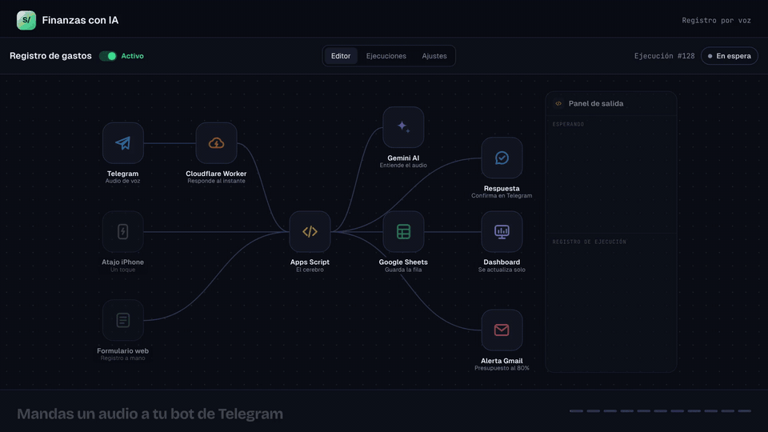
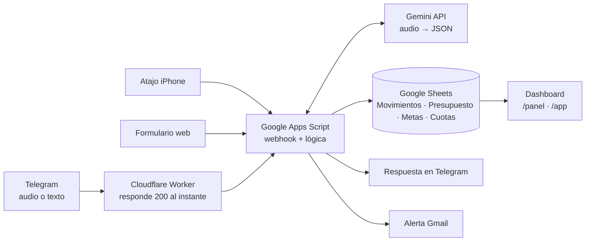
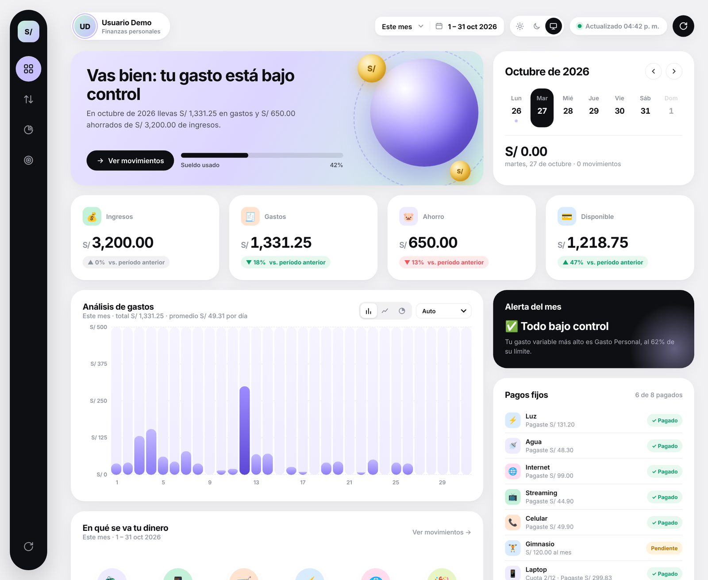
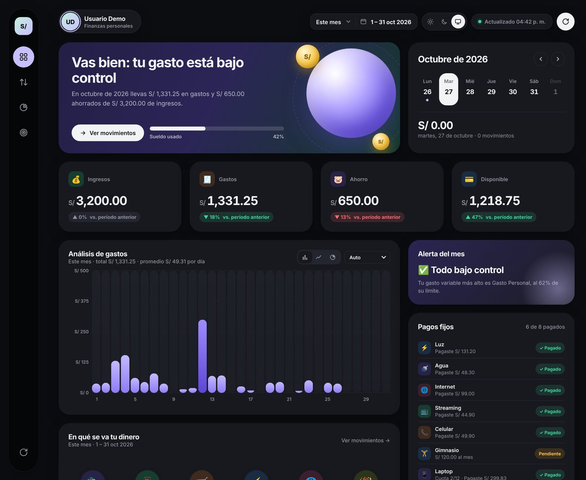
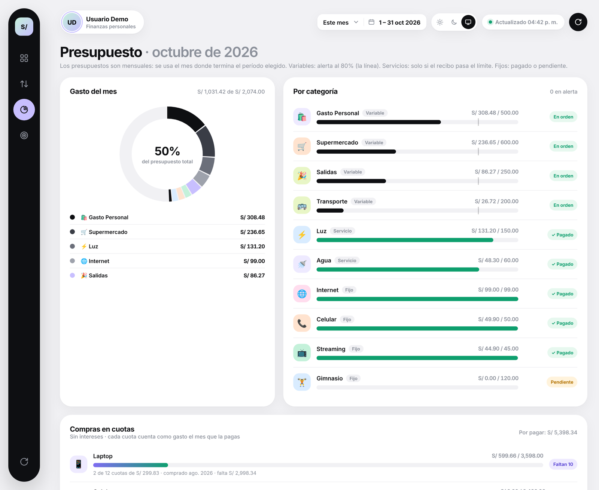
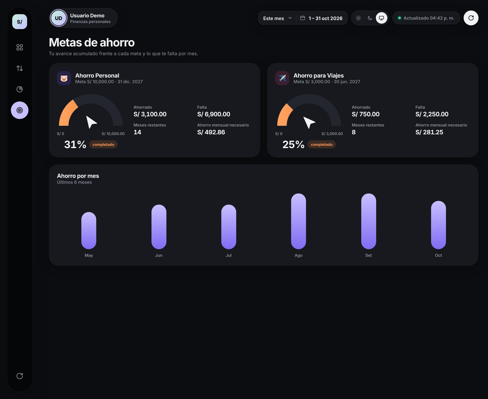
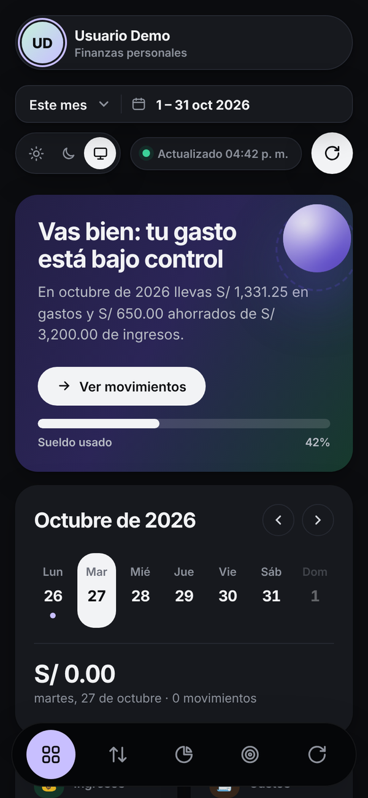

# Finanzas con IA 🎙️💸

**Registra tus gastos con un audio de Telegram.** Gemini entiende el monto y la categoría, se guarda en tu Google Sheet y tu dashboard se actualiza solo, con alertas por correo cuando te acercas a tu presupuesto.



> **English summary.** A personal-finance tracker you control by voice. Send a voice note to a Telegram bot. A Cloudflare Worker acknowledges it instantly, Google Apps Script downloads the audio, and Gemini extracts amount, category, note and date as JSON. The movement is saved to Google Sheets and shown on a live dashboard (light/dark, budgets, savings goals, installments), with e-mail alerts at 80% and 100% of each budget. Runs entirely on free tiers (Google + Cloudflare). There are no servers to maintain, and your data stays in your own Google account.

---

## Qué hace

- 🎙️ **Registro por voz o texto** desde Telegram: *"gasté 45 soles en el almuerzo"*, *"ahorré 200 para viajes"*, *"borra el último"*.
- 🧠 **Gemini** transcribe el audio y devuelve un JSON con monto, categoría, nota y fecha. Entiende fechas relativas ("ayer", "el 3 de noviembre").
- 📊 **Dashboard web**: gastos del mes, análisis por período (hoy, semana, mes, año o un rango), gráfico de barras, líneas o anillo, pagos fijos, metas de ahorro con indicador semicircular, y modo claro, oscuro o sistema.
- 💳 **Compras en cuotas sin intereses**: *"compré una laptop a 3598 en 12 cuotas"*. El bot divide el total y lleva la cuenta de cada pago.
- 🔔 **Alertas por correo**: los gastos variables avisan al 80% y al 100%, los servicios avisan si el recibo pasa el límite y los fijos avisan si te cobran de más.
- 📱 **Otros registros**: Atajo de iPhone (un toque), formulario web, y app para la pantalla de inicio en iPhone y Android.

## Arquitectura



Más detalle en [docs/ARQUITECTURA.md](docs/ARQUITECTURA.md) y código destacado en [docs/FRAGMENTOS.md](docs/FRAGMENTOS.md).

## Capturas

| Inicio (claro) | Inicio (oscuro) |
|---|---|
|  |  |

| Presupuesto | Metas de ahorro | Celular |
|---|---|---|
|  |  |  |

*Todas las capturas usan datos ficticios.*

🎬 Videos del flujo: [horizontal](media/flujo_horizontal.mp4) · [vertical](media/flujo_vertical.mp4) · Landing animada: [`landing/index.html`](landing/index.html)

## Tecnologías

| Pieza | Para qué |
|---|---|
| **Google Apps Script** (JavaScript V8) | Webhook, lógica de registro, alertas y servidor del dashboard |
| **Google Sheets** | Base de datos: movimientos, presupuestos, metas y cuotas |
| **Gemini API** | Transcripción y extracción estructurada (salida JSON) |
| **Telegram Bot API** | Entrada por voz o texto, botones de confirmación y comandos |
| **Cloudflare Workers** | Intermediario del webhook y páginas `/panel`, `/registro` y `/app` (PWA) |
| **HTML, CSS y SVG puros** | Dashboard sin librerías de gráficos, con modo claro y oscuro |

## Retos que resolví

- **Telegram reintentaba los mensajes.** Apps Script responde con una redirección 302 y Telegram la toma como error, así que reenviaba el mismo audio una y otra vez. La solución fue un **Cloudflare Worker** que responde `200` al instante y reenvía el mensaje en segundo plano con `ctx.waitUntil`, más un control de `update_id` repetidos con `LockService` y `CacheService`.
- **Modelos de Gemini saturados o retirados.** El bot pide la lista de modelos disponibles y arma solo su orden de respaldo: primero los modelos *flash*, luego los *lite*. Si un modelo da 404 lo descarta para siempre, y si recibe un 503 reintenta en dos vueltas.
- **Presupuestos realistas.** Cada categoría es *fija* (pagado o pendiente, con aviso de cobro mayor), *servicio* (avisa solo si el recibo pasa el límite) o *variable* (avisa al 80% y al 100%).
- **Cuotas sin intereses.** La última cuota absorbe los céntimos para que el total cuadre exacto. Si borras el pago de una cuota, el plan vuelve atrás solo.
- **Una sola APK para todos.** La página `/app` del Worker pide el enlace del panel de cada persona y lo guarda solo en su celular. Así la misma app de Android sirve para cualquier usuario.

## Estructura de este repositorio

```
docs/      ARQUITECTURA.md (diagramas y decisiones) · FRAGMENTOS.md (código destacado)
landing/   index.html (página animada, publicada con GitHub Pages)
media/     GIF, videos y capturas (datos ficticios)
```

Este repositorio es la **vitrina** del proyecto. El código completo (Apps Script, Worker y dashboard) está en un repositorio privado. En **[docs/FRAGMENTOS.md](docs/FRAGMENTOS.md)** puedes ver las partes más interesantes: el webhook sin reintentos, el respaldo automático de modelos de Gemini y el cálculo de cuotas.

## ¿Quieres usarlo?

Lo instalo y lo dejo funcionando en tu propia cuenta de Google: tu Sheet, tu bot de Telegram, tu dashboard y tu app en el celular. Escríbeme por LinkedIn. Si eres reclutador o vas a entrevistarme, también puedo darte acceso de lectura al código completo.

## Seguridad

- **No hay ninguna clave en el código.** Los tokens van en *Propiedades del script* de Apps Script y en las *Variables* del Worker.
- `TOKEN` en `Code.gs` viene como `CAMBIA_ESTE_TOKEN`. Cámbialo por uno propio y no lo publiques.
- El Worker solo acepta mensajes de Telegram que traen la clave secreta (`CLAVE`), y el bot solo responde a tu `TG_USER_ID`.
- Tus datos viven en **tu** Google Sheet. Gemini solo recibe el audio o texto de cada mensaje.

## Licencia

Material publicado como portafolio personal. Consulta [LICENSE](LICENSE).

---

Hecho por **Alexander Cordova** · Lima, Perú 🇵🇪
