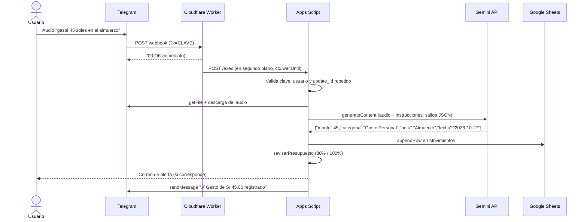

# Arquitectura

## Flujo de un audio

## Componentes

| Componente | Archivo | Responsabilidad |
|---|---|---|
| Entrada HTTP | `Code.gs` → `doPost`, `doGet` | Telegram, Atajo (JSON con `token`), formulario y dashboard |
| Registro y alertas | `Code.gs` → `registrar`, `revisarPresupuesto`, `avisar` | Guarda el movimiento y envía alertas por tipo de presupuesto |
| Bot | `Telegram.gs` | Webhook, comandos, botones, borrado y llamada a Gemini con reintentos y respaldo de modelos |
| Cuotas | `Cuotas.gs` | Planes de pago, siguiente cuota y reversión al borrar |
| Fórmulas | `Reparar.gs` | Fórmulas de Presupuesto, Resumen y Metas según la configuración regional |
| Dashboard | `Dashboard.html` | Interfaz con HTML, CSS y SVG puros. Se actualiza cada 30 s y solo redibuja si cambian los datos |
| Intermediario | `worker.js` | `200` inmediato a Telegram, `/panel`, `/registro`, `/app` (PWA para Android) y `assetlinks.json` |

## Hojas del Google Sheet

| Hoja | Columnas |
|---|---|
| Movimientos | Fecha · Año-Mes · Categoría · Tipo (Gasto, Ingreso o Ahorro) · Monto · Nota · Registrado |
| Presupuesto | Categoría · Límite · Gastado · % · Estado · Tipo (fijo, servicio o variable) |
| Metas | Categoría · Meta · Fecha límite · Ahorrado acumulado · … |
| Cuotas | Producto · Total · Cuotas · Monto cuota · Pagadas · Fecha compra · Estado · Último pago · Primer pago |

## Decisiones de diseño

- **Google Sheets como base de datos.** Es gratis, el usuario puede ver y editar sus datos, y no hay servidor que mantener.
- **Salida JSON de Gemini** (`responseMimeType: application/json`, `temperature: 0`). Las respuestas son estables y fáciles de validar.
- **Respaldo de modelos dinámico.** Los modelos se retiran con el tiempo, así que el bot consulta `models.list`, prioriza los *flash* y *lite* estables y descarta los que responden 404.
- **El dashboard no usa librerías.** Carga rápido dentro de Apps Script y se controla al detalle, incluidos el modo oscuro y los gráficos SVG.
